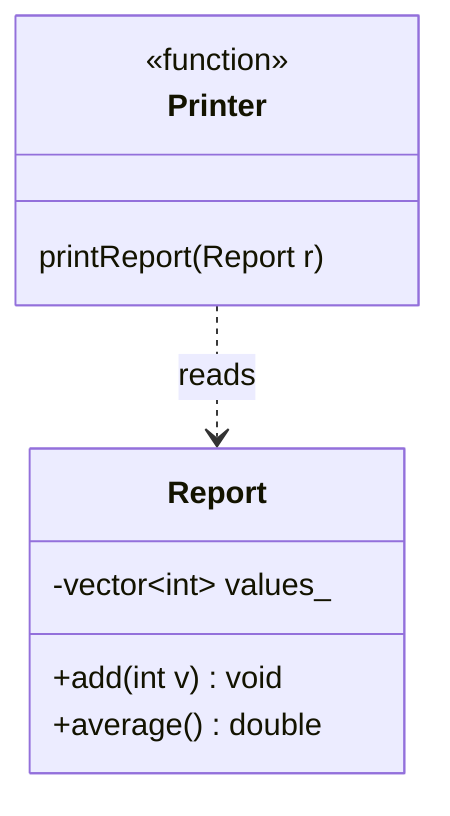
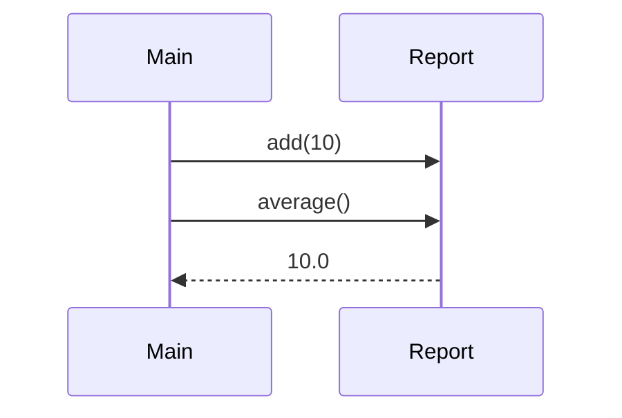

# Class Plan: Design the Architecture

## Goal

Before anyone moves code from C to C++, each team designs the target structure of Montana Tech Miner on Mermaid: a class diagram, a file-to-role table, and a sequence diagram of one frame. There is no single correct answer. Along the way we practice UML, relationships between objects, and justifying design decisions. The goal is to compare Alpha and Beta afterwards and combine the best ideas into one `docs/architecture.md`.

## Ground Rules

- Nobody writes or moves code in this class. The deliverable is **documents only**.
- Alpha and Beta work **separately**. Each team has one document: `docs/architecture-alpha.md` and `docs/architecture-beta.md`.
- The starting point is `main.c` as it is on `main` after the stamina merge.
- C++ in the OOP style of C# or Java: single inheritance, interfaces (abstract classes) only where there are two implementations. No multiple inheritance.
- MVC adapted to a game loop: the **Model** holds state and rules, the **View** draws, the **Controller** turns keys into input for the Model.
- Dependencies go one way. View and Controller may know the Model. The Model knows nobody and never includes raylib.
- We must be able to test the rules without opening a window.
- Existing behavior (movement, collisions) must not change. This is a restructuring, not a feature.
- Branch names: `[team]/feature/architecture/[surname]` and `[team]/feature/architecture/integration`. Never create a branch named just `alpha/feature/architecture` (or `beta/...`), because it would be a "folder" for the other branches.

### Stamina rules (the only new requirement)

- Maximum stamina is 100 (`PLAYER_MAX_STAMINA`).
- A jump costs 15 (`JUMP_STAMINA_COST`).
- Stamina is never below 0 or above 100.
- When stamina is below the jump cost, movement is 25% slower and jumps are 50% lower.
- The stamina bar is blue (green is reserved for health).
- Later, eating food will restore stamina (`STAMINA_FROM_FOOD`). Your design should make that easy to add.

## Roles

| Who                     | Role                                                                                                                              |
|-------------------------|-----------------------------------------------------------------------------------------------------------------------------------|
| Alpha team + Alpha lead | Design the architecture and write `docs/architecture-alpha.md`                                                                    |
| Beta team + Beta lead   | Design the architecture and write `docs/architecture-beta.md`                                                                     |
| Robert                  | Facilitator and reviewer. Helps teams with Mermaid syntax and asks questions, but does not give the answer or write requirements  |
| Dr. Pach                | Compares the two documents, leads the final discussion, prepares the combined `docs/architecture.md`                              |

## Phase 1: Solo analysis (10 minutes)

Each student works **alone**, on paper, with `main.c` open.

- Mark in `main.c` what you think belongs together (variables, functions, constants).
- Mark what is a rule that must always hold, and what is only presentation.
- Write down your own proposed list of classes. Do not talk yet.

**Done when:** you have a marked-up `main.c` and a list of classes on paper.

## Phase 2: Compare inside the team

Sit together with your lead and compare your papers.

- **Disagreements are the valuable part.** Record each one in the document with the decision you made and why.
- Use the questions at the bottom of this plan as a guide.
- Decide who drives which part (see Phase 3). Rotate the roles halfway through.

**Done when:** the team has one agreed list of classes and a list of recorded disagreements.

## Phase 3: Write the document

Create `docs/architecture-<team>.md` containing:

- **A. Class diagram** in Mermaid. Label each relationship: composition, association, or dependency.
- **B. Table** with four columns: file, role (Model / View / Controller), justification, and which smoke checklist item lives here.
- **C. Things that are not classes**: a list with one sentence of reasoning each.
- **D. Class justifications**: for every class, three sentences on why it exists and one cost of that decision.
- **E. Sequence diagram of one frame** (one iteration of `while (!WindowShouldClose())`) in which the player presses Space with 20 stamina, from reading keys to drawing.
- **F. Recorded disagreements** from Phase 2, each with the decision and the reason.

Work split: one person drives the class diagram, one the table, one the sequence diagram. Every member must be able to explain **any** element.

**Priority if time runs out:** A and B are required. C, D and E can be finished in the next class together with the combined `docs/architecture.md`.

## Phase 4: Pull Request and review inside the team

Each team uses the branch convention from the Ground Rules. Every student creates `[team]/feature/architecture/[surname]`, and the lead collects the pieces into `[team]/feature/architecture/integration`.

- The lead opens one PR for review only. **Do NOT click Merge.**
- The reviewer is the next person alphabetically in the team.
- At least 3 comments: 🟡 should, 🔵 nit, and at least one positive.
- Use **Start a review**, then submit with **Approve** or **Request changes**.
- Robert may add comments about diagrams that contradict each other.

## Self-check before the PR

- Diagrams A and E agree with each other (every object in the sequence exists in the class diagram).
- Every relationship on diagram A is labeled.
- No arrow goes from the Model to the View or the Controller.
- The Model does not include raylib anywhere.
- Every class protects a rule or has a role in polymorphism. If it only wraps functions, justify it or remove it.
- Every item of the stamina rules above has a place in table B.
- Each member can explain any element of the document.

## Questions to think about

These are **not** requirements. Use them in Phase 2.

- In `struct Player`, what is state and what are rules? Which rules could you test without a window?
- Where does the knowledge "which row is the floor" live today? In how many places?
- Who should know the stamina limit, who the jump cost, and who the numbers 0.75 and 0.5? Who decides that the player is exhausted?
- The rules say nothing about stamina 0. What happens then, and who decides?
- Is the animation counter a game rule or presentation?
- Does any arrow on your diagrams go from Model to View or Controller? What would that mean for testing?
- Does each class protect something, or does it just wrap functions?
- What changes in the frame after the one in part E, and where does your design show it?

## Mermaid syntax example

This example is **not** from the game. You can use it to learn the syntax.

## Assessment

You are **not** graded on matching a reference solution. You are graded on:

- whether your diagrams agree with each other,
- whether each decision has an argument,
- whether you can explain your own document.

## Definition of Done

- `docs/architecture-alpha.md` and `docs/architecture-beta.md` contain at least parts A and B.
- Each team PR was reviewed inside the team and **not merged**.
- Every disagreement from Phase 2 is recorded with a decision and a reason.
- Every student can explain any element of their team's document.

## What comes next

Dr. Pach and Robert compare the two documents. The best ideas from both go into one shared `docs/architecture.md`. Only after that does the restructuring start, in small PRs: skeleton first (directories, Makefile, unit test framework), then one class at a time with its tests.
